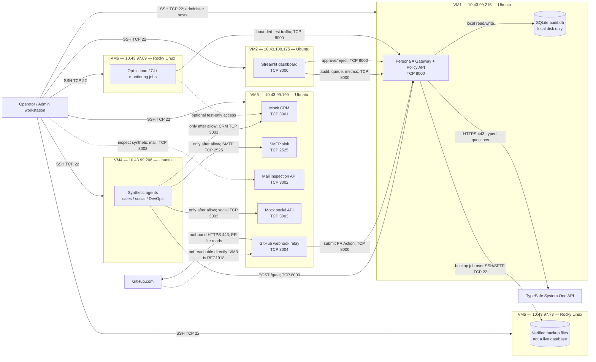

# Distributed VM Deployment Plan

**Status:** architecture and deployment sequence; not yet deployed.  
**Topology:** the six supplied private VMs. VM passwords and API credentials are not
part of this document or the repository.

## 1. Fixed VM assignments

| VM | Private IP | OS | Hosted role | Listening service ports |
|---|---|---|---|---|
| VM1 | `10.43.99.216` | Ubuntu | Persona A gateway, policy engine, one local SQLite audit database | TCP 8000 |
| VM2 | `10.43.100.175` | Ubuntu | Streamlit dashboard; HTTP client only, no database mount | TCP 3000 |
| VM3 | `10.43.99.199` | Ubuntu | Mock CRM, SMTP sink, social API, GitHub relay | TCP 3001, 3002, 2525, 3003, 3004 |
| VM4 | `10.43.99.206` | Ubuntu | Synthetic sales, social, and DevOps agents | No inbound app port |
| VM5 | `10.43.97.73` | Rocky Linux | Offline SQLite backup destination and restore drills | SSH/SFTP TCP 22 from VM1 |
| VM6 | `10.43.97.69` | Rocky Linux | Bounded load tests, CI jobs, optional monitoring | No inbound app port |

SSH management uses the `estudiante` account and the local key referenced by
`infra/ssh_config`. The key stays on the operator machine. Login passwords must not be
stored in `.env`, scripts, inventory, or this plan.

The private addresses span three subnets (`10.43.99.0/24`, `10.43.100.0/24`, and
`10.43.97.0/24`). Successful SSH from the operator to each VM does **not** prove
east-west routing between VMs. Verify routing and host firewalls before binding services
to the private interfaces.

## 2. Deployment and request-flow diagram

The last dotted GitHub edge is intentionally not an implemented ingress path. A
`10.43.x.x` address is private; GitHub.com cannot POST to VM3 directly without an
approved VPN, secure reverse tunnel, or controlled public ingress. Until that is
provided and reviewed, test the relay with locally signed synthetic webhooks. Never
expose port 3004 directly to the public Internet.

## 3. Runtime behavior

1. VM4 creates a synthetic `Action` and posts it to VM1 `POST /gate`. The GitHub relay
   on VM3 may submit an Action only after signature verification, repository allowlist
   validation, and PR metadata collection.
2. VM1 validates and evaluates the action, makes one outbound HTTPS request to TypeSafe,
   applies the configured deterministic/policy logic, and records the result in the
   SQLite file on VM1's local disk.
3. VM1 returns `allow`, `ask`, `deny`, or `pending`. Only `allow` can authorize an
   effect. An `ask` action remains stopped until the gateway records a human decision;
   `deny` and `pending` never execute an effect.
4. For synthetic actions, the agent on VM4 sends approved CRM, social, or email effects
   to the matching VM3 endpoint (3001, 3003, or 2525 respectively). These are isolated
   fake services; the SMTP sink never relays mail externally. Repository scenarios do
   not execute Git operations.
5. The dashboard on VM2 polls VM1's audit, queue, and metrics API and posts approvals
   back to VM1. VM2 must never mount or open VM1's SQLite database.
6. A backup process on VM1 uses SQLite's online backup API, verifies
   `PRAGMA integrity_check`, and sends the completed copy to VM5 over SSH/SFTP. Provision
   a dedicated, restricted SSH keypair on VM1 for this transfer and authorize its public
   key for writes to the backup directory on VM5; never copy the operator's private key
   to VM1. VM5 is backup-only; do not run SQLite over NFS or use VM5 as a live database.
7. VM6 runs explicitly bounded tests against VM1 (and, if needed, the isolated VM3
   simulators). Do not start unbounded load jobs or share their credentials with
   unrelated services.

This is distributed service placement, not distributed execution of a single JEV
decision. SQLite remains single-writer, and this design has no automatic gateway
failover. Do not add active-active gateways, shared SQLite, Celery/RabbitMQ, Ray, or
Kubernetes until measurements and a separate architecture decision justify them.

## 4. Network access policy

Apply host/network firewall rules before deployment. The table is the intended minimum,
not a claim that these rules are already installed:

| Destination | Permit source | Port | Purpose |
|---|---|---:|---|
| VM1 | VM2, VM3, VM4, VM6 | TCP 8000 | Dashboard, relay, agent and test calls to gateway |
| VM1 | Operator management network | TCP 22 | SSH administration |
| VM2 | Operator management network | TCP 3000 | Dashboard UI; restrict to admin/VPN network |
| VM2 | Operator management network | TCP 22 | SSH administration |
| VM3 | VM4 and approved operator/test hosts | TCP 3001, 3002, 3003, 3004, 2525 | Simulated APIs; relay ingress only from an approved private path |
| VM3 | VM1/VM2/VM4/VM6 as needed | TCP 22 | SSH administration; narrow to management source |
| VM4 | Operator management network | TCP 22 | SSH administration; no inbound agent service |
| VM5 | VM1 | TCP 22 | Backup transfer; optionally operator for restore administration |
| VM6 | Operator management network | TCP 22 | SSH administration; no inbound load service |
| VM1, VM3 | Internet egress | TCP 443 | TypeSafe from VM1; GitHub API from VM3 |

Do not allow general Internet ingress to VM1:8000, VM3:3001-3004/2525, VM5, or VM6.
If VM2:3000 or VM3 relay ingress must be reached from outside the private network,
require VPN or a separately reviewed TLS reverse proxy and authentication.
The current HTTP service URLs carry the gate token without transport encryption.
Restrict them to a trusted private segment; if any path crosses an untrusted network,
put TLS/mTLS in front of the service before transmitting tokens or action payloads.

## 5. Configuration and secret placement

The ignored repository-root `.env` is an operator-side address/configuration worksheet
with empty secret fields. It is **not** the file to deploy to every host. Create a
separate owner-readable `.env` on each VM (mode `0600`) containing only the variables
that host needs:

| Host | Required runtime configuration |
|---|---|
| VM1 | TypeSafe key, gateway token, model/endpoint, policy config, local SQLite path |
| VM2 | Bind dashboard to `10.43.100.175`, gateway base URL (`http://10.43.99.216:8000`), gateway token, dashboard port, approver label |
| VM3 | Bind simulators to `10.43.99.199`, gateway URL/token, relay allowlist, GitHub read token and webhook secret (only if webhook ingress is enabled), writes disabled |
| VM4 | Gateway URL/token, CRM URL `http://10.43.99.199:3001`, social URL `http://10.43.99.199:3003`, SMTP host `10.43.99.199`, port `2525` |
| VM5 | Backup directory and VM1's dedicated SSH public key with directory-scoped permissions; no gateway or TypeSafe secret |
| VM6 | Test target `http://10.43.99.216:8000`, low worker cap; no TypeSafe key |

Generate a unique high-entropy `GATE_TOKEN`; do not reuse a VM login password. Store the
TypeSafe key only on VM1, GitHub credentials only on VM3, and do not put any credential
in CLI arguments or source control. `GITHUB_ENABLE_WRITES=false` remains mandatory until
the test repository and human review procedure are explicitly approved.

The code currently has no implemented gateway service, gateway container, or
Persona A's environment parsing. Confirm actual variable names, response contracts,
health routes, and SQLite location with Persona A before VM1 deployment. The configuration
above is the target contract; it is not evidence that VM1 is ready to run.

Compose publishes dashboard/world ports on loopback by default. On VM2 and VM3 set
`VM2_BIND_IP=10.43.100.175` and `VM3_BIND_IP=10.43.99.199` in their respective host
`.env` files to make those services reachable on the private interfaces; the firewall
must still restrict their allowed sources. Gateway port 8000 must receive equivalent
private-interface/firewall treatment in Persona A's deployment.

## 6. Ordered implementation and rollout

### Phase 0 — contract and network readiness

- Freeze Action/Decision JSON schemas and the gateway routes with Persona A.
- Confirm the exact health, audit, queue, approval, and metrics endpoints consumed by
  the dashboard.
- From each required source VM, test private routing to its target IP and TCP port.
  SSH success from the operator alone is insufficient. Record firewall/routing results.
- Decide on a private GitHub webhook path. Until decided, do not register an external
  webhook to the private VM3 address.

**Exit criteria:** agreed API contract, successful east-west tests for required flows,
no public inbound ports exposed.

### Phase 1 — baseline host setup

- Verify OS/hostname/Python/Docker status with `bash infra/check_hosts.sh`.
- Install supported Python and Docker/Compose using approved OS repositories.
- Provision service directories and host firewall rules according to section 4.
- Keep SSH private key on the operator host; restrict SSH access and avoid password
  automation.

**Exit criteria:** six hosts reachable by SSH alias and each reports required runtime
and free disk capacity.

### Phase 2 — VM1 gateway and local audit store

- Deploy only after Persona A's gateway and configuration have landed and passed tests.
- Create `/var/lib/jev-gate` owned by the gateway service account with restrictive
  permissions; place SQLite locally there.
- Install VM1-only `.env`; bind gateway to the private network (or all interfaces with
  firewall restrictions if application binding requires it).
- Start the gateway, verify health, authenticated `POST /gate`, fail-closed behavior,
  audit write, and queue behavior using synthetic data.

**Exit criteria:** health is green; one synthetic allow/ask/deny path is demonstrated;
JEV failure cannot cause an unsafe effect; SQLite integrity check passes.

### Phase 3 — VM3 isolated simulated world

- Deploy CRM 3001, mail API 3002 and sink 2525, social API 3003, relay 3004.
- Confirm mail stays local and each API health check works from its allowed source.
- Keep GitHub writes false. Test webhook HMAC using synthetic signed payloads only.

**Exit criteria:** service health checks pass, state persists in per-service volumes,
network ACLs restrict each port to required peers.

### Phase 4 — VM2 dashboard

- Install VM2-only `.env` with gateway URL/token; start Streamlit on 3000.
- Verify live audit/queue/metrics reads, error visibility, and human approve/reject
  round-trip against VM1.
- Restrict dashboard reachability to the operator network/VPN.

**Exit criteria:** all views load from actual gateway endpoints and an approval changes
the persisted decision state.

### Phase 5 — VM4 agents and controlled effects

- Deploy agents in dry-run mode first; verify Action schema and unique IDs.
- Run one limited scenario per agent; inspect VM1 audit and VM3 fake service state.
- Only test non-dry-run effects after an explicit `allow`, using fictional data, with
  small `--count` and no real Git operations.

**Exit criteria:** denied, pending, and ask decisions never execute; allowed sample
effects reach only their corresponding VM3 mock services.

### Phase 6 — VM5 backup and recovery

- Limit SSH/SFTP so VM1's backup identity can write to VM5's backup directory.
- Create a dedicated transfer key on VM1, pin VM5's host key, and authorize only that
  key on VM5 for the backup directory; keep the operator key off all VMs.
- Run the backup utility, compare SHA-256, inspect SQLite integrity, and perform a
  restore drill to a new file (never over the live database).
- Audit rows can contain action payloads/PII: restrict read access, define retention,
  and encrypt backup storage at rest under the organization's key-management process
  before automatic scheduling.

**Exit criteria:** verified off-host copy and documented successful restore drill.

### Phase 7 — VM6 load tests and operational handoff

- Establish low-load baseline first; run bounded concurrency and duration settings.
- Measure gateway latency, JEV cost, SQLite growth/lock behavior, and VM CPU/memory.
- Keep optional monitoring and future scaling decisions evidence-based.

**Exit criteria:** no data loss, defined tested capacity and stop thresholds, and
operator runbooks cover rollback and recovery.

## 7. Current state and explicit non-goals

- Persona B's dashboard, simulators, agents, relay, and backup utility exist locally and
  have unit/integration coverage; the support deployment helper is not a six-host
  orchestrator.
- Persona A's gateway is not yet implemented, so VM1 cannot be deployed end-to-end.
- No commands in this plan have been run against the VMs; no service ports or firewall
  rules are asserted to be active.
- Docker is unavailable in the current development environment, so container builds
  and Compose runtime checks remain outstanding.
- The real TypeSafe probe has not been invoked. Add the API key to VM1's restricted
  `.env` only after the provider account is ready; the probe requires explicit
  confirmation and may incur usage.
- No real emails, social posts, repository writes, public webhook exposure, shared
  network database, automatic failover, or production traffic are part of this rollout.
