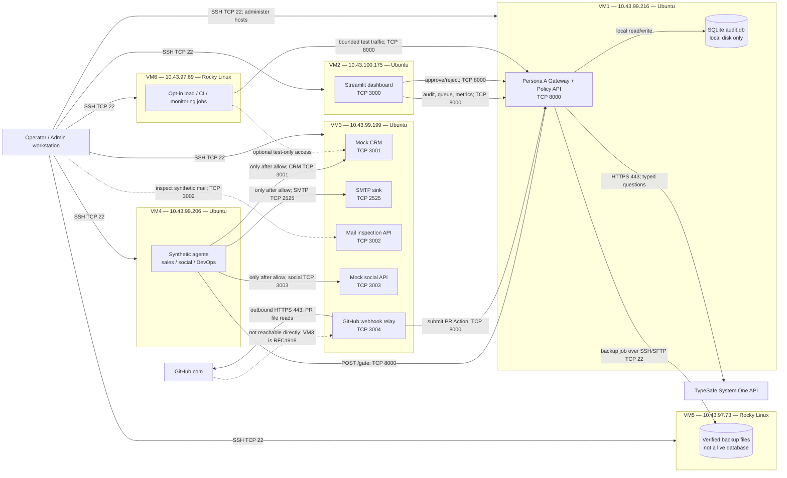

# Distributed VM Deployment Plan

**Status:** VM1–VM6 test deployment complete. VM1–VM5 backup and VM6 bounded Jev tests
are verified. GitHub's relay now maps to Action v2 locally, but there is no real GitHub
webhook ingress or end-to-end GitHub test. This is not a production-readiness claim.
**Topology:** the six supplied private VMs. VM passwords and API credentials are not
part of this document or the repository.

## 1. Fixed VM assignments

| VM | Private IP | OS | Hosted role | Listening service ports |
|---|---|---|---|---|
| VM1 | `10.43.99.216` | Ubuntu | Persona A gateway, policy engine, one local SQLite audit database | TCP 8000 |
| VM2 | `10.43.100.175` | Ubuntu | Streamlit dashboard; HTTP client only, no database mount | TCP 3000 |
| VM3 | `10.43.99.199` | Ubuntu | Mock CRM, SMTP sink, social API, GitHub relay | TCP 3001, 3002, 2525, 3003, 3004 |
| VM4 | `10.43.99.206` | Ubuntu | Synthetic sales, social, and DevOps agents | No inbound app port |
| VM5 | `10.43.97.73` | Rocky Linux | Offline SQLite backup destination and restore drills | SSH/SFTP TCP 22 from VM1 |
| VM6 | `10.43.97.69` | Rocky Linux | Bounded load tests, CI jobs, optional monitoring | No inbound app port |

SSH management uses the `estudiante` account and the local key referenced by
`infra/ssh_config`. The key stays on the operator machine. Login passwords must not be
stored in `.env`, scripts, inventory, or this plan.

The private addresses span three subnets (`10.43.99.0/24`, `10.43.100.0/24`, and
`10.43.97.0/24`). Successful SSH from the operator to each VM does **not** prove
east-west routing between VMs. Verify routing and host firewalls before binding services
to the private interfaces.

## 2. Deployment and request-flow diagram

The last dotted GitHub edge is intentionally not an implemented ingress path. A
`10.43.x.x` address is private; GitHub.com cannot POST to VM3 directly without an
approved VPN, secure reverse tunnel, or controlled public ingress. Until that is
provided and reviewed, test the relay with locally signed synthetic webhooks. A public
dashboard demo does not require a GitHub webhook or public gateway: it can display
sanitized sample data. If the demo itself is Internet-accessible, expose only the
dashboard through an approved HTTPS hosting/edge service with access controls; do not
publish VM1, VM3, VM5, or their credentials.

## 3. Runtime behavior

1. VM4 creates a synthetic `Action` and posts it to VM1 `POST /gate`. The GitHub relay
   on VM3 may submit an Action only after signature verification, repository allowlist
   validation, and PR metadata collection.
2. VM1 validates and evaluates the action, makes one outbound HTTPS request to TypeSafe,
   applies the configured deterministic/policy logic, and records the result in the
   SQLite file on VM1's local disk.
3. VM1 returns `allow`, `ask`, `deny`, or `pending`. Only `allow` can authorize an
   effect. An `ask` action remains stopped until the gateway records a human decision;
   `deny` and `pending` never execute an effect.
4. For synthetic actions, the agent on VM4 sends approved CRM, social, or email effects
   to the matching VM3 endpoint (3001, 3003, or 2525 respectively). These are isolated
   fake services; the SMTP sink never relays mail externally. Repository scenarios do
   not execute Git operations.
5. The dashboard on VM2 polls VM1's audit, queue, and metrics API and posts approvals
   back to VM1. VM2 must never mount or open VM1's SQLite database. A public demo must
   use synthetic or explicitly sanitized data and must not expose operator approval
   capabilities to anonymous visitors.
6. A backup process on VM1 uses SQLite's online backup API, verifies
   `PRAGMA integrity_check`, and sends the completed copy to VM5 over SSH/SFTP. Provision
   a dedicated, restricted SSH keypair on VM1 for this transfer and authorize its public
   key for writes to the backup directory on VM5; never copy the operator's private key
   to VM1. VM5 is backup-only; do not run SQLite over NFS or use VM5 as a live database.
7. VM6 runs explicitly bounded tests against VM1 (and, if needed, the isolated VM3
   simulators). Do not start unbounded load jobs or share their credentials with
   unrelated services.

MCP is optional, not a prerequisite for this flow. A future agent can call a protected
connector directly or through MCP; in either case the connector/client must send a
contract-valid Action to the gateway before making the external side effect. MCP itself
does not provide authorization, approval, or safety enforcement.

This is distributed service placement, not distributed execution of a single JEV
decision. SQLite remains single-writer, and this design has no automatic gateway
failover. Do not add active-active gateways, shared SQLite, Celery/RabbitMQ, Ray, or
Kubernetes until measurements and a separate architecture decision justify them.

## 4. Network access policy

Apply host/network firewall rules before deployment. The table is the intended minimum,
not a claim that these rules are already installed:

| Destination | Permit source | Port | Purpose |
|---|---|---:|---|
| VM1 | VM2, VM3, VM4, VM6 | TCP 8000 | Dashboard, relay, agent and test calls to gateway |
| VM1 | Operator management network | TCP 22 | SSH administration |
| VM2 | Operator management network | TCP 3000 | Dashboard UI; restrict to admin/VPN network |
| VM2 | Operator management network | TCP 22 | SSH administration |
| VM3 | VM4 and approved operator/test hosts | TCP 3001, 3002, 3003, 3004, 2525 | Simulated APIs; relay ingress only from an approved private path |
| VM3 | VM1/VM2/VM4/VM6 as needed | TCP 22 | SSH administration; narrow to management source |
| VM4 | Operator management network | TCP 22 | SSH administration; no inbound agent service |
| VM5 | VM1 | TCP 22 | Backup transfer; optionally operator for restore administration |
| VM6 | Operator management network | TCP 22 | SSH administration; no inbound load service |
| VM1, VM3 | Internet egress | TCP 443 | TypeSafe from VM1; GitHub API from VM3 |

Do not allow general Internet ingress to VM1:8000, VM3:3001-3004/2525, VM5, or VM6.
If VM2:3000 or VM3 relay ingress must be reached from outside the private network,
require VPN or a separately reviewed TLS reverse proxy and authentication.
All gateway routes except unauthenticated `GET /health` require `X-Gate-Token`.
The current HTTP service URLs carry that token without transport encryption. Restrict
them to a trusted private segment; if any path crosses an untrusted network, put
TLS/mTLS in front of the service before transmitting tokens or action payloads.

## 5. Configuration and secret placement

The ignored repository-root `.env` is an operator-side address/configuration worksheet
with empty secret fields. It is **not** the file to deploy to every host. Create a
separate owner-readable `.env` on each VM (mode `0600`) containing only the variables
that host needs:

| Host | Required runtime configuration |
|---|---|
| VM1 | Unique gateway token, TypeSafe API key, official endpoint/model settings, policy configuration, and local SQLite volume/path. |
| VM2 | Bind dashboard to `10.43.100.175`, gateway base URL (`http://10.43.99.216:8000`), gateway token, dashboard port, approver label |
| VM3 | Bind simulators to `10.43.99.199`, gateway URL/token, relay allowlist, GitHub read token and webhook secret (only if webhook ingress is enabled), writes disabled |
| VM4 | Gateway URL/token, CRM URL `http://10.43.99.199:3001`, social URL `http://10.43.99.199:3003`, SMTP host `10.43.99.199`, port `2525` |
| VM5 | Backup directory and VM1's dedicated SSH public key with directory-scoped permissions; no gateway or TypeSafe secret |
| VM6 | Test target `http://10.43.99.216:8000`, low worker cap; no TypeSafe key |

Generate a unique high-entropy `GATE_TOKEN`; do not reuse a VM login password. Put
`TYPESAFE_API_KEY` only in VM1's restricted `.env`; `GATE_TOKEN` protects inbound
gateway requests and is a separate credential. The TypeSafe transport is deployed in VM1 and verified with synthetic gateway requests.
Keep the key only in VM1's restricted `.env`; do not put any credential in CLI arguments
or source control.
`GITHUB_ENABLE_WRITES=false` remains mandatory until the test repository and human
review procedure are explicitly approved.

The repository now contains the local gateway, container, Compose file, token
authentication, and the agreed API contract. The canonical routes are `POST /gate`,
`GET /gate/{action_id}`, `GET /decisions`, `GET /approvals`,
`POST /gate/{action_id}/approve`, `GET /metrics`, and `GET /health`; only health is public.
VM1 Compose requires `GATE_TOKEN`, persists
SQLite in the `gateway_data` volume, and publishes loopback by default; configure
`VM1_BIND_IP` only after approving the private interface and firewall rules. The
local gateway code now connects to the official TypeSafe System One HTTPS API when
`TYPESAFE_API_KEY` is set in VM1's restricted `.env`. The live provider integration has
been verified; if the key is absent or the provider fails, the gateway retains the safe
`pending` behavior.

Compose publishes gateway/dashboard/world ports on loopback by default. On VM1–VM3 set
the corresponding `VM1_BIND_IP=10.43.99.216`, `VM2_BIND_IP=10.43.100.175`, and
`VM3_BIND_IP=10.43.99.199` in their respective host `.env` files to make services
reachable on the private interfaces; the firewall must still restrict allowed sources.

## 6. Ordered implementation and rollout

### Phase 0 — contract and network readiness

- Action v2, Decision v2, and gateway routes are defined in `contracts/openapi.yaml`
  and `contracts/schemas/`. The GitHub relay's Action mapping is validated locally
  against JSON Schema, Pydantic, and the deterministic extractor. `docs/validate_contract.py`
  checks that `docs/schemas/` copies stay synchronized.
- Dashboard routes are
  `/decisions`, `/approvals`, and `/metrics`, with approval resolution on
  `/gate/{action_id}/approve`. Agent approval polling reads `/gate/{action_id}`.
- Confirm per-VM variable names and private bind addresses. Do not distribute a shared
  `.env` or transfer secrets with rsync.
- From each required source VM, test private routing to its target IP and TCP port.
  SSH success from the operator alone is insufficient. Record firewall/routing results.
- No GitHub.com ingress is configured. It is not needed for a synthetic dashboard demo.
  For future GitHub integration, decide on approved HTTPS webhook ingress or outbound
  polling; never register an external webhook directly to VM3's private address.

**Exit criteria:** contract and required private service paths validated. External
firewall/ACL rules still require confirmation by the network administrator.

### Phase 1 — baseline host setup

- `bash infra/check_hosts.sh` and Docker/Compose readiness were checked. Docker Engine
  and Compose now run on all six hosts; VM6's Rocky Python 3.9 and VM1's Ubuntu Python
  3.10 compatibility were also exercised by the deployed utilities.
- Keep host updates and Docker/Compose upgrades under the operator's approved OS
  maintenance process.
- Provision service directories and host firewall rules according to section 4.
- Keep SSH private key on the operator host; restrict SSH access and avoid password
  automation.

**Exit criteria:** met for the current test deployment. External firewall/ACL review
and production host-hardening evidence remain outstanding.

### Phase 2 — VM1 gateway and local audit store

- Deploy the checked-in gateway only after host Docker/Compose, `.env` mode 600, and
  private routing/firewall are ready.
- Create `/var/lib/jev-gate` owned by the gateway service account with restrictive
  permissions; place SQLite locally there.
- Install VM1-only `.env`; bind gateway to the private network (or all interfaces with
  firewall restrictions if application binding requires it).
- Start the gateway, verify health, authenticated `POST /gate`, fail-closed behavior,
  audit write, and queue behavior using synthetic data.

**Exit criteria:** health is green; one synthetic allow/ask/deny path is demonstrated;
JEV failure cannot cause an unsafe effect; SQLite integrity check passes.

### Phase 3 — VM3 isolated simulated world

- Deploy CRM 3001, mail API 3002 and sink 2525, social API 3003, relay 3004.
- Confirm mail stays local and each API health check works from its allowed source.
- Keep GitHub writes false. Test webhook HMAC using synthetic signed payloads only.

**Exit criteria:** service health checks pass, state persists in per-service volumes,
network ACLs restrict each port to required peers.

### Phase 4 — VM2 dashboard

- Install VM2-only `.env` with gateway URL/token; start Streamlit on 3000.
- Verify live audit/queue/metrics reads, error visibility, and human approve/reject
  round-trip against VM1.
- Restrict dashboard reachability to the operator network/VPN.

**Exit criteria:** all views load from actual gateway endpoints and an approval changes
the persisted decision state.

### Phase 5 — VM4 agents and controlled effects

- Deploy agents in dry-run mode first; verify Action schema and unique IDs.
- Run one limited scenario per agent; inspect VM1 audit and VM3 fake service state.
- Only test non-dry-run effects after an explicit `allow`, using fictional data, with
  small `--count` and no real Git operations.

**Exit criteria:** denied, pending, and ask decisions never execute; allowed sample
effects reach only their corresponding VM3 mock services.

### Phase 6 — VM5 backup and recovery

- VM5's SFTP-only `jevbackup` account is configured and VM1 successfully uploaded,
  listed, and removed a temporary test file.
- `scripts/backup_sqlite.py` is deployed on VM1. Because the host SSH user cannot read
  Docker's volume directory, create the SQLite Online Backup inside `infra-gateway-1`,
  copy that snapshot to a mode-600 temporary file on VM1, and upload it using the pinned
  SFTP identity.
- On 2026-10-18, the audit database snapshot was uploaded to
  `/backups/audit-20261018T042225892454Z.sqlite3`. VM1 downloaded it, verified matching
  SHA-256 `0852a1b022c94eff3b5ea74fceed1bf60c5db3111e83abe95fd53b4cf64cede3`, passed
  SQLite integrity checking, and copied it to a separate temporary database for a
  restore check. Temporary local/container copies were removed; the VM5 archive remains.
- Audit rows can contain action payloads/PII: restrict read access, define retention,
  and encrypt backup storage at rest under the organization's key-management process
  before automatic scheduling.

**Exit criteria:** met for the manual backup and restore-check. Retention, at-rest
encryption, and scheduling remain prerequisites for automated backups.

### Phase 7 — VM6 load tests and operational handoff

- VM6's `estudiante` account has Docker access without sudo. Deploy the bounded
  standard-library baseline runner with `bash infra/deploy_support.sh loadtest`.
- Runner deployment was verified on 2026-10-18 under
  `/home/estudiante/.local/share/mynameisjev/scripts/`; it compiles with VM6's Python
  3.9 runtime.
- The runner uses sequential concurrency 1 and permits at most 10 synthetic dry-run
  actions by default and caps concurrency at 5. The user approved a `$0.01` estimated-
  spend ceiling for each run; the runner requires at least `$0.0005` per requested action.
- On 2026-10-18, all 10 requests reached real Jev `jev-1.13.0` through VM1 and returned
  `allow`; VM1 SQLite confirms 10 `vm6-baseline` actions and 10 Jev allow decisions.
  Total estimated cost was `$0.000345618` (8,229 input / 1,330 output tokens). Jev
  latency was 212.5 ms minimum, 230.6 ms median, 389.4 ms p95; gateway round trip was
  228.5 ms minimum, 249.3 ms median, 416.9 ms p95.
- After resource review, the user approved 10 more requests at a maximum concurrency
  of 5 and the same `$0.01` estimated-spend ceiling. All 10 returned real Jev
  `jev-1.13.0` `allow` decisions; VM1 SQLite confirms they persisted. Estimated cost was
  `$0.000345828` (8,234 input / 1,330 output tokens). Jev latency was 242.3 ms minimum,
  295.8 ms median, 341.9 ms p95; gateway round trip was 294.5 ms minimum, 353.1 ms
  median, 381.1 ms p95.
- SQLite grew from 454,656 to 499,712 bytes during the additional 10 actions. An
  after-run idle snapshot showed VM1 at 4 vCPU, 8.6 GiB available memory, gateway
  container at 48.4 MiB, and VM6 at 4 vCPU / 11 GiB available memory. These are not
  peak measurements; this small batch does not establish maximum capacity or safe
  sustained concurrency.
- Before any larger or longer run, capture peak CPU/memory and database growth during
  the workload, and agree a new request/cost limit.
- Keep optional monitoring and future scaling decisions evidence-based.

**Exit criteria:** no data loss, defined tested capacity and stop thresholds, and
operator runbooks cover rollback and recovery.

## 7. Current state and explicit non-goals

The dated observations below form a chronological history; older entries record the
state on their date and may be superseded by later dated entries in this section. The
summary at the top is the current readiness statement.

- On 2026-10-17 the deployment helper successfully built and deployed VM1 gateway,
  VM2 dashboard, and VM3 simulated world; VM4 agent images were built and all three
  agents completed their bounded `--dry-run` scenarios. No secrets were copied by
  rsync. The remote `.env` files on VM1–VM4 are owned by `estudiante` with mode 600.
- VM1 gateway is healthy on `10.43.99.216:8000`; `/health` reports authentication
  configured and `jev_configured=false`. A protected route returned 401 without the
  token and 200 with it. SQLite contains 31 decisions, all `pending`; its online backup
  smoke check returned `PRAGMA integrity_check=ok`.
- VM2 dashboard is healthy on `10.43.100.175:3000`; authenticated requests from its
  container to gateway `/decisions`, `/approvals`, and `/metrics` returned 200.
- VM3 CRM (3001), mail API (3002), SMTP sink (2525), social API (3003), and relay
  (3004) are healthy on the private interface. VM4 reached VM1 and the VM3 service
  ports; the SMTP banner was reachable. GitHub writes were verified disabled. VM3's
  relay authenticated successfully to VM1.
- The original VM4 sales, social, and DevOps dry-run (5, 4, and 7 actions) happened
  before TypeSafe was integrated; all 16 were `pending`, with no effects. On 2026-10-18,
  one fresh action from each agent was sent to VM1 in `--dry-run` mode and received a
  real Jev-backed `allow` (245.9 ms email, 315.8 ms social, 230.3 ms PR). The first
  attempt exposed a stale `contracts/schemas/decision.schema.json` that rejected the
  new provider metadata after the provider request completed; that request was also
  billed. After synchronizing the shared contract and rebuilding VM4, all three runs
  passed. Four provider calls total reported 3,390 input / 596 output tokens and
  `$0.000142380` estimated cost. VM3 mail and social stores remained empty; no simulator
  effect or repository write ran.
- Docker Engine and Compose are installed on all six VMs. VM5 is not an application
  host and needs no Compose service. A production SQLite backup was verified on VM5 by
  matching SHA-256, SQLite integrity check, and restore-check to a separate temporary
  file. The verified archive remains in `/backups`; automated scheduling is not enabled.
- VM6 has no application Compose deployment. The `estudiante` account has Docker group
  access and `docker run --rm hello-world` succeeds without sudo. The bounded runner is
  deployed and syntax-checked under VM6's Python 3.9. Ten sequential and ten
  concurrency-5 dry-run Jev actions completed under a `$0.01` cap and a mode-600 `.env`
  containing only the gateway token and VM1 target. No non-dry-run effect was generated.
- The separate real TypeSafe API probe was run successfully with one synthetic request:
  HTTP 200, model `jev-1.13.0`, 303.9 ms, and usage reported as 490 input / 72 output
  tokens. This probe was independent of the gateway.
- On 2026-10-18, the updated gateway was deployed to VM1. `/health` reported
  `jev_configured=true`. Two synthetic `POST /gate` requests reached TypeSafe model
  `jev-1.13.0`: a social action exercised `noul` and `choice` (405.2 ms,
  791/133 input/output tokens, `$0.000033222`); a PR action exercised `noul`, `choice`,
  and `score` (218.7 ms, 968/197 tokens, `$0.000040656`). Both initially required
  review. The VM2 dashboard client approved the first and rejected the second; VM1
  persisted the resulting `allow`/`deny` decisions and provider metadata. Combined
  recorded cost was `$0.000073878`, pending approvals returned to zero, and SQLite
  `PRAGMA integrity_check` returned `ok`.
- These were synthetic decisions only. No social post, email, CRM write, PR write, or
  other external effect was executed; GitHub writes remain disabled. The 16 earlier
  VM4 dry-run actions predate this integration and have not been rerun against TypeSafe.
- No real emails, social posts, repository writes, public webhook exposure, shared
  network database, automatic failover, or production traffic are part of this rollout.
